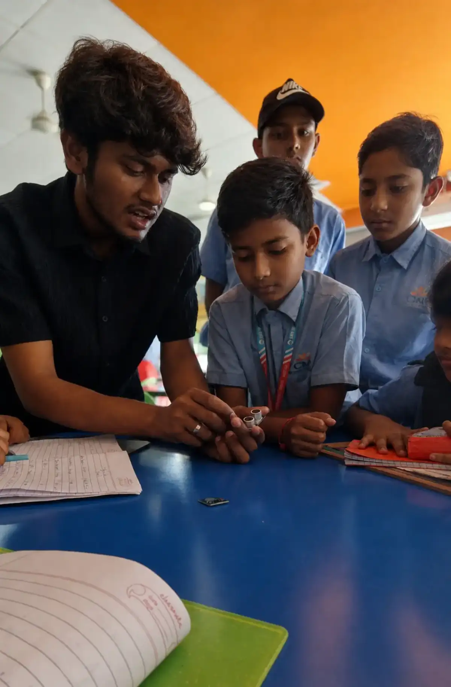

  <picture>
    <source media="(prefers-color-scheme: dark)" srcset="header-dark.svg?v=1781461115">
    <source media="(prefers-color-scheme: light)" srcset="header-light.svg?v=1781461115">
    
  </picture>

  <picture>
    <source media="(prefers-color-scheme: dark)" srcset="https://readme-typing-svg.demolab.com?font=Fira+Code&weight=600&size=20&pause=1200&color=C8A96E&center=true&vCenter=true&width=600&lines=Full-Stack+Developer;AI+%26+Data+Science;IoT+%26+Cybersecurity;Building+defence-grade+simulators">
    
  </picture>

    

  
  
  
  
  
  

 

## 👋 About Me

I'm **Shankumar**, a B.Tech Computer Science (Data Science) student at **CMRCET** and an intern at the **Military College of Electronics & Mechanical Engineering (MCEME)**, where I build AI- and AR/VR-powered training simulators for the Indian Army.

I work across **full-stack development**, **data science**, and **IoT security**, and I like building things that are scalable, efficient, and secure by design.

- 🔭 **Currently working on:** IoT security frameworks & computer-vision pipelines
- 🤝 **Open to collaborate on:** full-stack products and open-source projects
- 🏆 **4× national hackathon winner** · GPA **9.11 / 10**
- 🎓 **Google Student Ambassador '26** · mentored **60+ students** at Atal Tinkering Labs
- 📫 **Reach me:** [shankumarpitta714@gmail.com](mailto:shankumarpitta714@gmail.com)

> *"I thrive on solving hard problems with real-world impact. Whether it's a midnight hackathon or a defence-grade simulator, I show up and ship."*

 

## 🛠️ Tech Stack

  <b>Languages</b>  
  

  <b>Frontend & Backend</b>  
  

  <b>Data, Cloud & DevOps</b>  
  

  <b>Hardware & IoT</b>  
  
    
  
  
  
  
  
  
  

## 🚀 Featured Projects

<table>
  <tr>
    <td width="50%" valign="top">
      <h3>🔐 AuthSphere</h3>
      <b>Self-hosted IoT security framework · Patented</b>
      
Certificate-driven security for resource-constrained IoT devices, with automated onboarding and zero vendor lock-in.

      <code>C++</code> <code>MQTT</code> <code>ECC</code> <code>PKI</code>
    </td>
    <td width="50%" valign="top">
      <h3>📚 ClassCom</h3>
      <b>Academic resource gateway · 210+ users</b>
      
Full-stack platform for study materials and assignment tracking, plus a print-order pipeline that has generated ₹2.6L+ in revenue.

      <code>Next.js</code> <code>Node.js</code> <code>MySQL</code>
    </td>
  </tr>
  <tr>
    <td width="50%" valign="top">
      <h3>🚁 DARKS Rakshak</h3>
      <b>Disaster-response drone system</b>
      
Dual-drone architecture: a carrier deploys an autonomous recon unit to improve survivor detection in flood rescues.

      <code>Python</code> <code>Computer Vision</code> <code>Autonomy</code>
    </td>
    <td width="50%" valign="top">
      <h3>🛡️ <a href="https://github.com/shankumar7/Snippet-scanner">Snippet Scanner</a></h3>
      <b>Static code security analyzer</b>
      
Flags OWASP Top 10 vulnerabilities in code snippets and suggests how to fix them.

      <code>Python</code> <code>OWASP</code> <code>Static Analysis</code>
    </td>
  </tr>
  <tr>
    <td width="50%" valign="top">
      <h3>🏥 Arogya Drishti</h3>
      <b>Secure hospital management system</b>
      
End-to-end hospital platform built with IoT security and data integrity at its core.

      <code>HealthTech</code> <code>IoT</code> <code>Secure by Design</code>
    </td>
    <td width="50%" valign="top">
      <h3>🍅 Tomato Sorter & TECHBOW</h3>
      <b>Computer vision & human-robot interaction</b>
      
Vision pipeline for automated produce sorting, paired with HRI research for intuitive robot interaction.

      <code>Computer Vision</code> <code>Robotics</code> <code>AgriTech</code>
    </td>
  </tr>
</table>

## 📌 On GitHub

  <a href="https://github.com/shankumar7/Auralearn">
    <picture>
      <source media="(prefers-color-scheme: dark)" srcset="https://github-readme-stats.shion.dev/api/pin/?username=shankumar7&repo=Auralearn&hide_border=true&bg_color=0d1117&title_color=C8A96E&text_color=c9d1d9&icon_color=C8A96E&description_lines_count=2">
      
    </picture>
  </a>
  <a href="https://github.com/shankumar7/Snippet-scanner">
    <picture>
      <source media="(prefers-color-scheme: dark)" srcset="https://github-readme-stats.shion.dev/api/pin/?username=shankumar7&repo=Snippet-scanner&hide_border=true&bg_color=0d1117&title_color=C8A96E&text_color=c9d1d9&icon_color=C8A96E&description_lines_count=2">
      
    </picture>
  </a>
   
  <a href="https://github.com/shankumar7/thefolioclub">
    <picture>
      <source media="(prefers-color-scheme: dark)" srcset="https://github-readme-stats.shion.dev/api/pin/?username=shankumar7&repo=thefolioclub&hide_border=true&bg_color=0d1117&title_color=C8A96E&text_color=c9d1d9&icon_color=C8A96E&description_lines_count=2">
      
    </picture>
  </a>
  <a href="https://itboard.vercel.app">
    <picture>
      <source media="(prefers-color-scheme: dark)" srcset="https://github-readme-stats.shion.dev/api/pin/?username=shankumar7&repo=itboard&hide_border=true&bg_color=0d1117&title_color=C8A96E&text_color=c9d1d9&icon_color=C8A96E&description_lines_count=2">
      
    </picture>
  </a>

## 🏅 Certifications & Achievements

| | |
|:--|:--|
| 🏆 | **4× Hackathon Winner** — national-level competitions |
| 🎓 | **Google Student Ambassador '26** — Google Developer Ecosystem |
| 🪖 | **Intern, MCEME** — defence training simulators (AI, AR/VR) |
| 📊 | **Tata Consultancy Services** — GenAI-Powered Data Analytics |
| 📈 | **Deloitte Australia** — Data Analytics Job Simulation |
| 🧑‍🏫 | **ATL Mentor** — guided 60+ students at Atal Tinkering Labs |

## 📊 GitHub Stats

  <picture>
    <source media="(prefers-color-scheme: dark)" srcset="https://github-readme-stats.shion.dev/api?username=shankumar7&show_icons=true&include_all_commits=true&count_private=true&hide_border=true&bg_color=0d1117&title_color=C8A96E&text_color=ffffff&icon_color=C8A96E&rank_icon=github">
    
  </picture>
  <picture>
    <source media="(prefers-color-scheme: dark)" srcset="https://streak-stats.demolab.com/?user=shankumar7&hide_border=true&background=0d1117&ring=C8A96E&fire=C8A96E&currStreakNum=ffffff&currStreakLabel=C8A96E&sideNums=ffffff&sideLabels=C8A96E&dates=888888&stroke=333333&timezone=Asia%2FKolkata">
    
  </picture>

 

  <picture>
    <source media="(prefers-color-scheme: dark)" srcset="https://github-readme-stats.shion.dev/api/top-langs/?username=shankumar7&hide_border=true&bg_color=0d1117&title_color=C8A96E&text_color=ffffff&layout=compact&card_width=500&langs_count=8&hide=roff,powershell">
    
  </picture>

 

  🐍 Contribution graph, refreshed every 6 hours  
  <picture>
    <source media="(prefers-color-scheme: dark)" srcset="https://raw.githubusercontent.com/shankumar7/shankumar7/output/github-contribution-grid-snake-dark.svg">
    
  </picture>

 

  

  <h3>Let's build something together 🤝</h3>
  
Open to internships, collaborations, and interesting problems. 
  <a href="https://shankumar.me">shankumar.me</a> · <a href="https://www.linkedin.com/in/shankumar7">LinkedIn</a> · <a href="mailto:shankumarpitta714@gmail.com">Email</a>

  <picture>
    <source media="(prefers-color-scheme: dark)" srcset="footer-dark.svg?v=1781461115">
    
  </picture>

